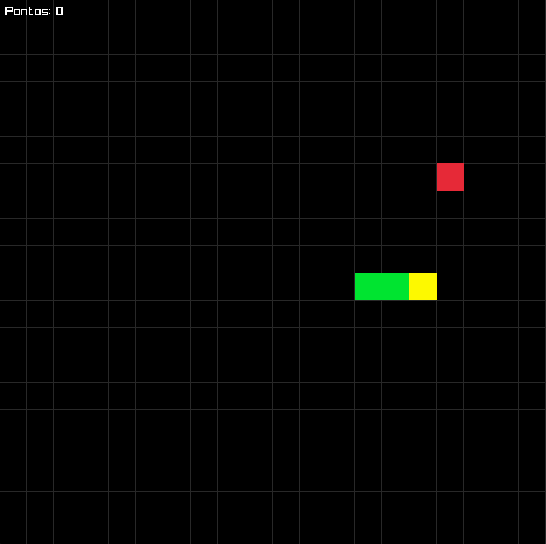

# Snake

Jogo da cobrinha clássico em **C++** com **[raylib](https://www.raylib.com/)**.

A cobra anda sozinha por uma grade. Coma a comida vermelha para crescer e marcar pontos, sem bater nas paredes nem no próprio corpo. Se a cobra preencher a grade inteira, você vence.

## Captura de tela



## Controles

| Tecla | Ação |
|---|---|
| `↑` / `W` | Cima |
| `↓` / `S` | Baixo |
| `←` / `A` | Esquerda |
| `→` / `D` | Direita |
| `R` | Reiniciar (após o fim de jogo) |
| `Esc` | Sair |

## Como rodar

### Requisitos

- Windows
- [MSYS2](https://www.msys2.org/) com o ambiente **UCRT64**

### Instalação

No terminal **MSYS2 UCRT64**:

```bash
pacman -S --needed mingw-w64-ucrt-x86_64-toolchain mingw-w64-ucrt-x86_64-raylib
```

Adicione `C:\msys64\ucrt64\bin` à variável de ambiente **Path** do Windows.

### Compilar e executar

Na pasta do projeto:

```bash
g++ *.cpp -o snake.exe -lraylib -lopengl32 -lgdi32 -lwinmm
./snake.exe
```